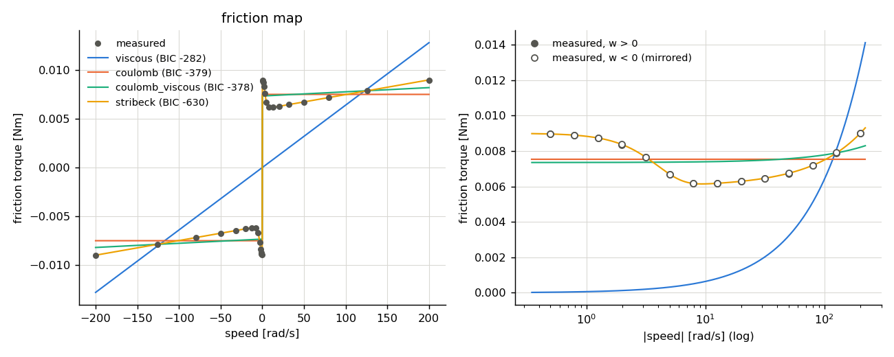
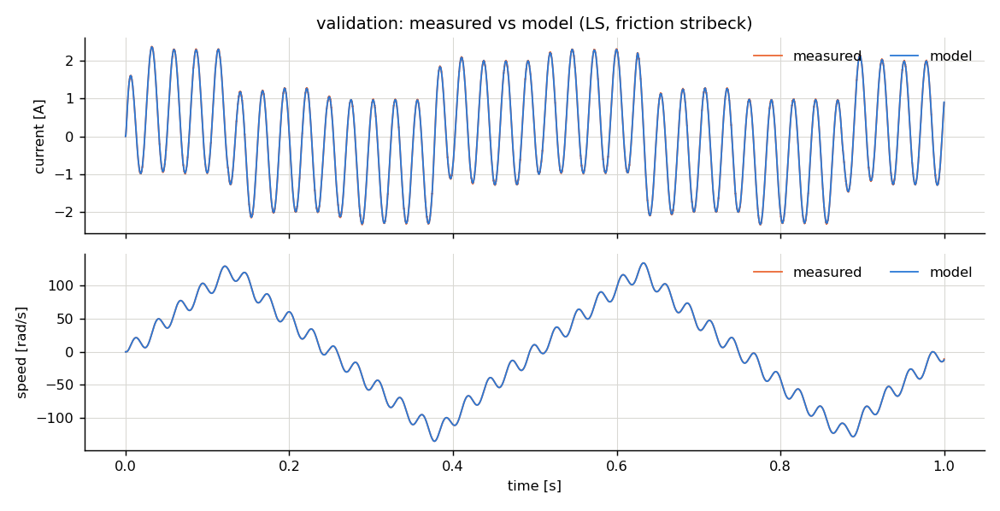

# Identification report: demo_dc

- motor: **dc**, samples: 20000, Ts = 0.0001 s
- created: 2026-11-06 15:20:02

## 1. Least-squares (equation error)

Electrical: R = 1.1501, L = 0.0006155, Ke = 0.045996, Kt = 0.045996
 (R^2 = 0.99997)

Mechanical equation  Te = J dw/dt + T_f(w), candidate friction models:

| model | k | rmse | r2 | aic | bic | J | B | Tc | Tst | ws | delta |
|---|---|---|---|---|---|---|---|---|---|---|---|
| stribeck | 5 | 0.000619 | 0.9999 | -2.66e+05 | -2.66e+05 | 2.401e-05 | 1.496e-05 | 0.006011 | 0.008384 | 4.429 | 2 |
| coulomb_viscous | 3 | 0.0006331 | 0.9999 | -2.652e+05 | -2.652e+05 | 2.4e-05 | 1.402e-05 | 0.006116 | nan | nan | nan |
| coulomb | 2 | 0.0009195 | 0.9998 | -2.518e+05 | -2.518e+05 | 2.401e-05 | nan | 0.007258 | nan | nan | nan |
| viscous | 2 | 0.003149 | 0.9977 | -2.075e+05 | -2.074e+05 | 2.4e-05 | 7.001e-05 | nan | nan | nan | nan |

## 2. Friction map (constant-speed test)

Torque = identified Kt x mean current at each settled speed set-point (Kt_identified / Kt_nominal = 0.9199).

| model | k | rmse | r2 | aic | bic | B | Tc | Tst | ws | delta |
|---|---|---|---|---|---|---|---|---|---|---|
| stribeck | 4 | 1.018e-05 | 1 | -635.7 | -630.4 | 1.509e-05 | 0.005991 | 0.009002 | 4 | 2 |
| coulomb | 1 | 0.001075 | 0.98 | -380.8 | -379.4 | nan | 0.007519 | nan | nan | nan |
| coulomb_viscous | 2 | 0.001047 | 0.981 | -380.3 | -377.6 | 4.31e-06 | 0.007353 | nan | nan | nan |
| viscous | 1 | 0.006177 | 0.3386 | -282.9 | -281.5 | 6.417e-05 | nan | nan | nan | nan |

**Selected friction model: `stribeck`** (lowest BIC). Stribeck shape (Tst, ws) taken from the friction map.

## 3. Output-error refinement

Replay measured voltage in the open-loop model; fit R, L, Kt, J, Tc, B (friction `stribeck`). cost 0.09183 -> 0.08383, 4 evaluations, 4 s.

## 4. Validation (independent experiment, voltage replay)

fit_pct = 100 (1 - |y - y_model| / |y - mean(y)|).  `truth` = replay with the true (hidden) model: the best achievable given sensor noise.

| params | channel | rmse | nrmse_range | fit_pct | r2 | max_abs |
|---|---|---|---|---|---|---|
| truth | i | 0.009944 | 0.002117 | 99.21 | 0.9999 | 0.04062 |
| truth | w | 0.02979 | 0.0001104 | 99.96 | 1 | 1.503 |
| LS | i | 0.0103 | 0.002193 | 99.18 | 0.9999 | 0.04133 |
| LS | w | 0.06437 | 0.0002385 | 99.91 | 1 | 1.44 |
| OE | i | 0.01048 | 0.002231 | 99.17 | 0.9999 | 0.04194 |
| OE | w | 0.07256 | 0.0002688 | 99.9 | 1 | 1.443 |

**Kept estimate: LS** (highest mean validation fit of i/iq and w among LS, OE)

## 5. Parameter error vs. ground truth

True friction model: `lugre`

| param | true | LS | LS_err% | OE | OE_err% |
|---|---|---|---|---|---|
| R | 1.15 | 1.15 | 0.01015 | 1.149 | -0.1303 |
| L | 0.00062 | 0.0006155 | -0.7263 | 0.000619 | -0.1558 |
| Kt | 0.046 | 0.046 | -0.008123 | 0.046 | 0.003601 |
| J | 2.4e-05 | 2.401e-05 | 0.02111 | 2.41e-05 | 0.4363 |
| Tc | 0.006 | 0.006011 | 0.1802 | 0.005979 | -0.3526 |
| Tst | 0.009 | 0.009002 | 0.02528 | 0.009002 | 0.02528 |
| ws | 4 | 4 | 0.01176 | 4 | 0.01176 |
| B | 1.5e-05 | 1.496e-05 | -0.2349 | 1.568e-05 | 4.515 |
| sigma0 | 50 | nan | nan | nan | nan |
| sigma1 | 0.05 | nan | nan | nan | nan |
