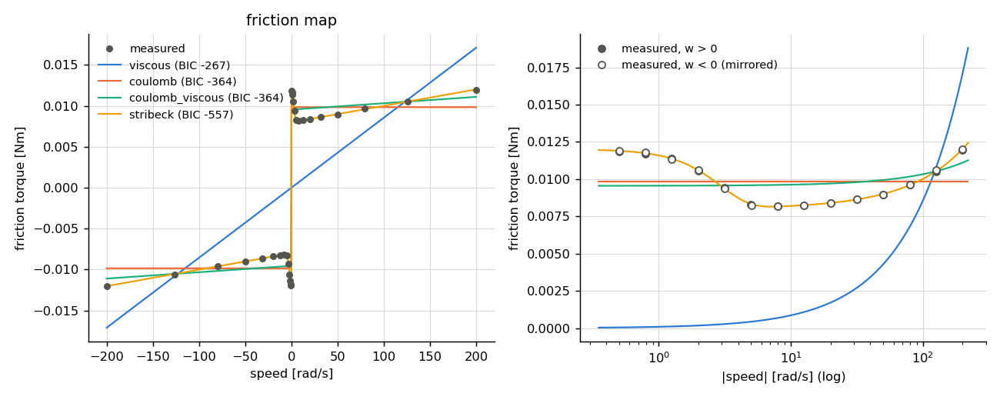
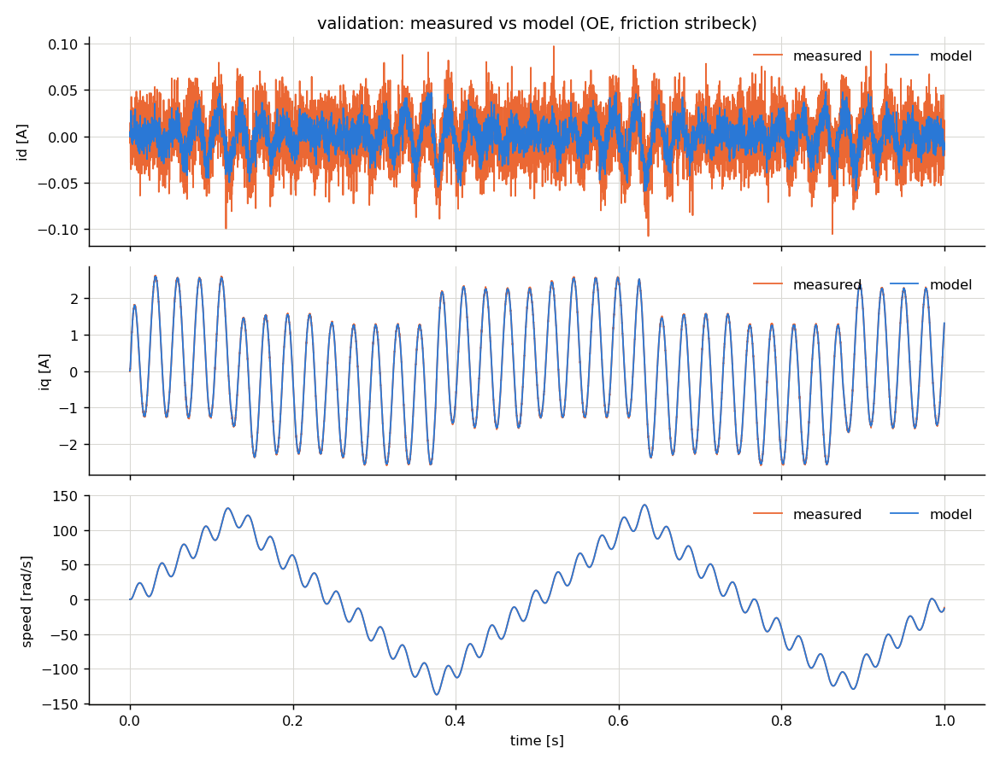

# Identification report: demo_pmsm

- motor: **pmsm**, samples: 20000, Ts = 0.0001 s
- created: 2026-11-04 04:39:39

## 1. Least-squares (equation error)

Electrical: R = 0.55006, Ld = 0.0008488, Lq = 0.0012401, psi = 0.010498, p = 4
 (R^2 = 0.99936)

Mechanical equation  Te = J dw/dt + T_f(w), candidate friction models:

| model | k | rmse | r2 | aic | bic | J | B | Tc | Tst | ws | delta |
|---|---|---|---|---|---|---|---|---|---|---|---|
| stribeck | 5 | 0.0009378 | 0.9999 | -2.515e+05 | -2.515e+05 | 3.204e-05 | 1.974e-05 | 0.007998 | 0.009845 | 3.612 | 2 |
| coulomb_viscous | 3 | 0.0009401 | 0.9999 | -2.514e+05 | -2.514e+05 | 3.204e-05 | 1.934e-05 | 0.008043 | nan | nan | nan |
| coulomb | 2 | 0.001318 | 0.9999 | -2.393e+05 | -2.392e+05 | 3.204e-05 | nan | 0.009635 | nan | nan | nan |
| viscous | 2 | 0.004144 | 0.9986 | -1.979e+05 | -1.979e+05 | 3.203e-05 | 9.246e-05 | nan | nan | nan | nan |

## 2. Friction map (constant-speed test)

Torque = identified Kt x mean current at each settled speed set-point (Kt_identified / Kt_nominal = 1.0498).

| model | k | rmse | r2 | aic | bic | B | Tc | Tst | ws | delta |
|---|---|---|---|---|---|---|---|---|---|---|
| stribeck | 4 | 3.746e-05 | 1 | -562.8 | -557.4 | 2.011e-05 | 0.007995 | 0.012 | 2.971 | 2 |
| coulomb | 1 | 0.001418 | 0.9797 | -365.3 | -364 | nan | 0.009846 | nan | nan | nan |
| coulomb_viscous | 2 | 0.001346 | 0.9817 | -366.2 | -363.5 | 7.778e-06 | 0.009546 | nan | nan | nan |
| viscous | 1 | 0.008018 | 0.3504 | -268.3 | -266.9 | 8.549e-05 | nan | nan | nan | nan |

**Selected friction model: `stribeck`** (lowest BIC). Stribeck shape (Tst, ws) taken from the friction map.

## 3. Output-error refinement

Replay measured voltage in the open-loop model; fit R, Ld, Lq, psi, J, Tc, B (friction `stribeck`). cost 0.179 -> 0.1619, 4 evaluations, 12 s.

## 4. Validation (independent experiment, voltage replay)

fit_pct = 100 (1 - |y - y_model| / |y - mean(y)|).  `truth` = replay with the true (hidden) model: the best achievable given sensor noise.

| params | channel | rmse | nrmse_range | fit_pct | r2 | max_abs |
|---|---|---|---|---|---|---|
| truth | id | 0.01995 | 0.09755 | 22.24 | 0.3953 | 0.07526 |
| truth | iq | 0.01975 | 0.003782 | 98.62 | 0.9998 | 0.08123 |
| truth | w | 0.02843 | 0.0001037 | 99.96 | 1 | 1.512 |
| LS | id | 0.02065 | 0.101 | 19.5 | 0.352 | 0.07549 |
| LS | iq | 0.02013 | 0.003855 | 98.59 | 0.9998 | 0.08361 |
| LS | w | 0.05047 | 0.000184 | 99.93 | 1 | 1.473 |
| OE | id | 0.01996 | 0.0976 | 22.2 | 0.3947 | 0.07561 |
| OE | iq | 0.0198 | 0.003792 | 98.62 | 0.9998 | 0.08256 |
| OE | w | 0.03449 | 0.0001258 | 99.95 | 1 | 1.513 |

**Kept estimate: OE** (highest mean validation fit of i/iq and w among LS, OE)

## 5. Parameter error vs. ground truth

True friction model: `stribeck`

| param | true | LS | LS_err% | OE | OE_err% |
|---|---|---|---|---|---|
| R | 0.55 | 0.5501 | 0.0117 | 0.5497 | -0.05917 |
| Ld | 0.00085 | 0.0008488 | -0.1407 | 0.0008493 | -0.08335 |
| Lq | 0.00125 | 0.00124 | -0.7933 | 0.00125 | 0.001808 |
| psi | 0.0105 | 0.0105 | -0.01641 | 0.0105 | 0.009177 |
| J | 3.2e-05 | 3.204e-05 | 0.1098 | 3.206e-05 | 0.1778 |
| Tc | 0.008 | 0.007998 | -0.02856 | 0.008002 | 0.03038 |
| Tst | 0.012 | 0.012 | -0.03109 | 0.012 | -0.03109 |
| ws | 3 | 2.971 | -0.9514 | 2.971 | -0.9514 |
| B | 2e-05 | 1.974e-05 | -1.277 | 2.023e-05 | 1.15 |
