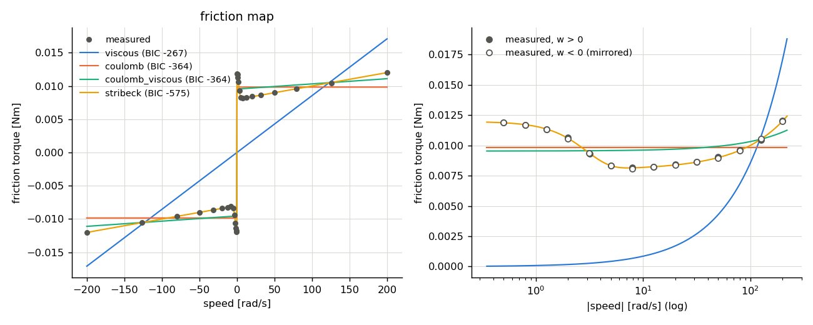
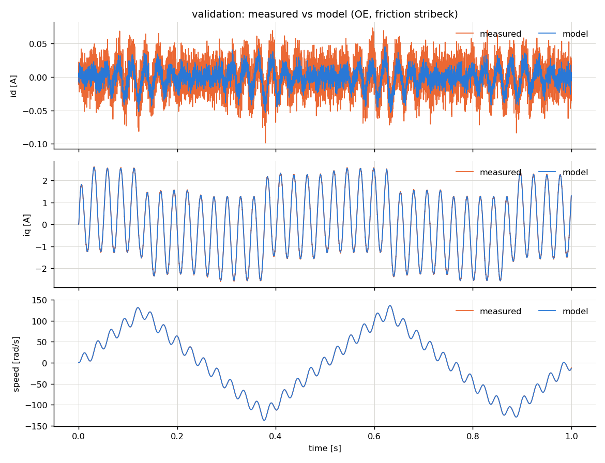

# Identification report: demo_pmsm_abc

- motor: **pmsm**, samples: 20000, Ts = 0.0001 s
- created: 2026-11-05 17:38:37

## 1. Least-squares (equation error)

Electrical: R = 0.54995, Ld = 0.00084957, Lq = 0.0012423, psi = 0.010497, p = 4
 (R^2 = 0.99956)

Mechanical equation  Te = J dw/dt + T_f(w), candidate friction models:

| model | k | rmse | r2 | aic | bic | J | B | Tc | Tst | ws | delta |
|---|---|---|---|---|---|---|---|---|---|---|---|
| stribeck | 5 | 0.0009173 | 0.9999 | -2.523e+05 | -2.523e+05 | 3.203e-05 | 2.025e-05 | 0.007954 | 0.008708 | 4.975 | 2 |
| coulomb_viscous | 3 | 0.0009188 | 0.9999 | -2.523e+05 | -2.522e+05 | 3.203e-05 | 1.984e-05 | 0.008 | nan | nan | nan |
| coulomb | 2 | 0.00132 | 0.9999 | -2.392e+05 | -2.392e+05 | 3.203e-05 | nan | 0.009633 | nan | nan | nan |
| viscous | 2 | 0.004118 | 0.9986 | -1.982e+05 | -1.981e+05 | 3.203e-05 | 9.256e-05 | nan | nan | nan | nan |

## 2. Friction map (constant-speed test)

Torque = identified Kt x mean current at each settled speed set-point (Kt_identified / Kt_nominal = 1.0497).

| model | k | rmse | r2 | aic | bic | B | Tc | Tst | ws | delta |
|---|---|---|---|---|---|---|---|---|---|---|
| stribeck | 4 | 2.732e-05 | 1 | -580.4 | -575.1 | 2.016e-05 | 0.007989 | 0.01198 | 3 | 2 |
| coulomb | 1 | 0.001415 | 0.9798 | -365.4 | -364.1 | nan | 0.009843 | nan | nan | nan |
| coulomb_viscous | 2 | 0.001343 | 0.9818 | -366.3 | -363.7 | 7.81e-06 | 0.009541 | nan | nan | nan |
| viscous | 1 | 0.008013 | 0.3506 | -268.3 | -267 | 8.549e-05 | nan | nan | nan | nan |

**Selected friction model: `stribeck`** (lowest BIC). Stribeck shape (Tst, ws) taken from the friction map.

## 3. Output-error refinement

Replay measured voltage in the open-loop model; fit R, Ld, Lq, psi, J, Tc, B (friction `stribeck`). cost 0.1345 -> 0.1191, 4 evaluations, 13 s.

## 4. Validation (independent experiment, voltage replay)

fit_pct = 100 (1 - |y - y_model| / |y - mean(y)|).  `truth` = replay with the true (hidden) model: the best achievable given sensor noise.

| params | channel | rmse | nrmse_range | fit_pct | r2 | max_abs |
|---|---|---|---|---|---|---|
| truth | id | 0.01632 | 0.09485 | 26.68 | 0.4624 | 0.063 |
| truth | iq | 0.01637 | 0.003122 | 98.86 | 0.9999 | 0.06584 |
| truth | w | 0.03083 | 0.0001124 | 99.96 | 1 | 1.498 |
| LS | id | 0.01724 | 0.1002 | 22.53 | 0.3999 | 0.06405 |
| LS | iq | 0.01664 | 0.003175 | 98.84 | 0.9999 | 0.06852 |
| LS | w | 0.05534 | 0.0002018 | 99.92 | 1 | 1.478 |
| OE | id | 0.01619 | 0.09412 | 27.24 | 0.4706 | 0.06308 |
| OE | iq | 0.01657 | 0.003161 | 98.84 | 0.9999 | 0.06404 |
| OE | w | 0.03454 | 0.000126 | 99.95 | 1 | 1.504 |

**Kept estimate: OE** (highest mean validation fit of i/iq and w among LS, OE)

## 5. Parameter error vs. ground truth

True friction model: `stribeck`

| param | true | LS | LS_err% | OE | OE_err% |
|---|---|---|---|---|---|
| R | 0.55 | 0.55 | -0.008363 | 0.5494 | -0.1096 |
| Ld | 0.00085 | 0.0008496 | -0.05003 | 0.0008491 | -0.1046 |
| Lq | 0.00125 | 0.001242 | -0.617 | 0.001251 | 0.06494 |
| psi | 0.0105 | 0.0105 | -0.0305 | 0.0105 | -0.01565 |
| J | 3.2e-05 | 3.203e-05 | 0.08895 | 3.206e-05 | 0.2005 |
| Tc | 0.008 | 0.007954 | -0.5777 | 0.008019 | 0.2352 |
| Tst | 0.012 | 0.01198 | -0.2075 | 0.01198 | -0.2075 |
| ws | 3 | 3 | 0.01459 | 3 | 0.01459 |
| B | 2e-05 | 2.025e-05 | 1.248 | 2.041e-05 | 2.035 |
